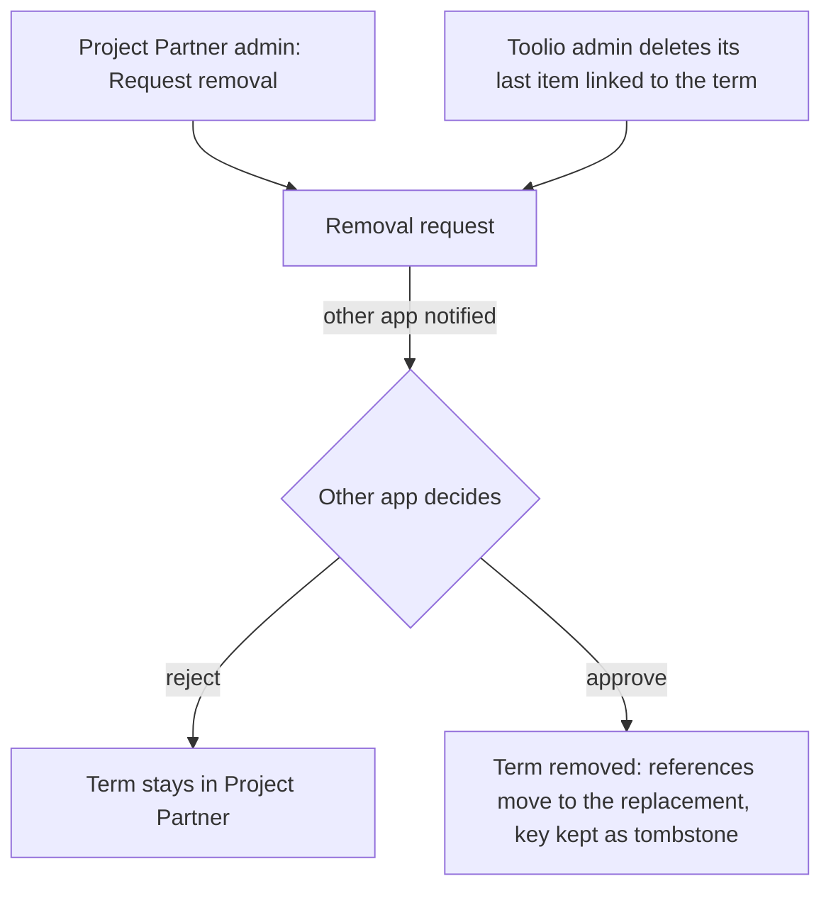

# Project Partner and Toolio integration contract

This is the canonical contract. Toolio's `docs/PROJECT_PARTNER_INTEGRATION.md` covers only the Toolio side and points here.

## Ownership

- **Project Partner** owns the general vocabulary, the upper level for everything: project categories, projects (one entry per revision family), tools, and materials.
- **Toolio** owns SKUs, pricing, guided sections, customer copy, orders, and accounts.
- Every Toolio project, catalog grouping, and inventory core links to a Project Partner term; there is no Toolio-only vocabulary. Project Partner may hold terms Toolio does not use.
- The databases are never shared. Toolio keeps a local mirror of the vocabulary, fed by the change feed below; Toolio's shop and checkout never call Project Partner.
- Where both apps had a tool or material before the merge, Toolio's wording is canonical and Project Partner's wording is kept as aliases. Project names are decided per project in review (see [Toolio project rebuild](#toolio-project-rebuild-final-step)).

## Toolio project rebuild (final step)

Toolio has more built-out guided projects; Project Partner has the stronger project structure (families, revisions, foundations). After switch-over, Toolio's guided projects are rebuilt for **identity only**:

- Each Toolio guided project links to one Project Partner family.
- Each Toolio catalog grouping (a project other projects are filed under, such as Tile or Flooring) links to a Project Partner project category, and the grouped projects' families carry that category.
- The project name is decided per project in crosswalk review (Project Partner's name, Toolio's name, or a new one); the other names become aliases.
- Toolio's foundation and variant links (`content_foundation_project_id`) follow the family's foundation structure.
- Toolio's ordering content is carried over unchanged: sections, section items, packages, default quantities, customization questions and rules.
- A changed slug gets a redirect, so customer URLs and `orders.project_slug` on past orders still resolve.

**Parity control.** The rebuild ships only when a before/after comparison of two exports (taken right before and right after) shows, for every guided project:

- the same visible cores per package (Essentials and Comprehensive) with the same default quantities;
- the same sections and section visibility;
- the same customization questions, options, and rules;
- the same released, coming soon, or hidden status;
- differences only in the fields the crosswalk decided to change (name, slug, foundation link), each listed in the report.

Same cores and quantities mean the same Day 1 / Day 2+ prices, since pricing reads only those. The comparison is a `verify.mjs` check added with the rebuild.

## Keys

- Every term has a `public_key`: lowercase kebab-case, immutable, unique across categories, projects, tools, and materials (one `vocab_keys` table).
- Terms that came from Toolio use Toolio's key when it is valid kebab-case: the core `sku` for tools and materials, `projects.slug` for projects and groupings. Otherwise review picks a key (flagged `BAD KEY`); Toolio's own SKU or slug is unchanged.
- Terms that exist only in Project Partner get a key derived from their name. A clash with any existing key is a crosswalk conflict, resolved by a person.
- Toolio stores the key, not its SKU, on a link, so renaming a Toolio SKU never breaks a link.
- A removed term leaves its key in `vocab_keys` as a tombstone (`removed_at`, `replaced_by_public_key`), so the key is never reissued and old references can be traced.

## Two-sided removal

A shared term (category, project, tool, or material) is permanently removed only when **both apps approve**. Either app can start the request; the request itself counts as that app's approval.



- **Started by Toolio.** Deleting a Toolio inventory core or project works as today (Toolio hides and deletes its own item). When it was the last Toolio item linked to the term, Toolio sends a removal request. Project Partner admins get a notification and approve or reject. Rejecting keeps the term as a Project Partner-only term.
- **Started by Project Partner.** An admin's Delete on a tool, material, project family, or category becomes **Request removal**, with an optional replacement term. Toolio staff see it in Toolio's Admin → Catalog → Project Partner. To approve, every Toolio item still linked to the term is relinked (to the replacement, or another term) or deleted in Toolio first; rejecting keeps the term in both apps.
- **Completion** happens in Project Partner, in the same transaction as the second approval:
  - references (step lists, user tools and materials, owned tools, family tool lists, aliases) move to the replacement term; a term that still has references and no replacement cannot be removed, and the approval fails with the list of references;
  - the term row is deleted and its key becomes a tombstone;
  - a `remove` event tells Toolio's mirror to drop the term.
- While a request is open the term stays fully usable in both apps. A requester can cancel an open request.
- Direct deletes of shared terms are blocked by a trigger; completing an approved request is the only path.

## New terms from Toolio

Toolio never creates shared terms itself. A new Toolio inventory core or project links to the term with the same normalized name when exactly one exists; otherwise Toolio proposes one.

- **Proposal.** `vocab_propose_term` records the proposed key (the Toolio `sku` or `slug`), name, description, and the waiting Toolio item, and notifies Project Partner admins.
- **Decision.** In Admin → **Requests**, an admin either adds the proposal as a new term (choosing type, category, and for tools specialty) or maps it to an existing term of a matching kind (a Toolio product to a tool or material, a project to a project family). Toolio links the waiting item when the decision syncs.
- **Withdrawal.** Toolio cancels a proposal when its item is deleted or no longer waits. Cancelling a proposal that was already decided returns the decision unchanged.

## Project Partner schema (added in phase 3)

| Object | Purpose |
| --- | --- |
| `vocab_keys (public_key PK, entity category/project/tool/material, removed_at, replaced_by_public_key)` | Global key registry; removed terms stay as tombstones |
| `public_key` on `tools`, `materials`, and family roots (`projects.parent_project_id IS NULL`) | FK to `vocab_keys`; immutable by trigger |
| `project_categories (public_key, name)` | Categories as vocabulary; replaces the free-text `projects.category` array |
| `project_family_categories (family_key, category_key)` | Which categories a family belongs to |
| `name_key` on `tools`, `materials` | Unique normalized name (Toolio's `inventory_item_name_comparison_key` rule) |
| `vocab_removal_requests (id, public_key, requested_by_app pp/toolio, requested_by_email, reason, replacement_key, pp_decision, pp_decided_by, toolio_decision, toolio_decided_by, status open/approved/rejected/cancelled, timestamps)` | Two-sided removal; the requesting app's decision is `approve` on creation |
| `vocab_aliases (public_key, alias, alias_key, source)` | Sources: `pp_name`, `pp_revision_name`, `toolio_name`, `alternates` |
| `project_family_tools (family_key, term_key, role, source)` | `role`: `required` or `substitute`; `source`: `steps` or `toolio_seed` |
| `vocab_term_proposals (id, entity tool/material/project, proposed_key, proposed_name, description, requested_by, toolio_item_kind, toolio_item_id, status open/approved/mapped/cancelled, result_key, decided_by, timestamps)` | Terms Toolio proposes for its waiting items (phase 5); one open proposal per Toolio item |
| `vocab_change_events (seq bigserial, entity, public_key, change_kind, payload, created_at)` | Change feed; `change_kind`: `upsert`, `remove` (payload carries `replaced_by_public_key`), `removal_request` and `term_proposal` (payload is the request's or proposal's current row); `payload` is the full current row |
| Delete guard trigger | Blocks direct deletes of categories, tools, materials, and family roots; only completing an approved removal request deletes them |

- The events table has no client access. Aliases and family tool lists are readable as the app needs them and writable by admins only. Removal requests are readable and decidable by admins only.
- **Admin screens.** Delete on a tool, material, project family, or category becomes **Request removal** (optional replacement, reason). Admin → **Requests** lists open removal requests from Toolio (Approve or Reject) and new terms from Toolio (add or map); each new one creates an admin notification.
- **Publishing.** Publishing a revision is a client-side `UPDATE projects SET publish_status = 'published'` in `confirmStatusChangeDirect` (`src/components/UnifiedProjectManagement.tsx`); there is no publish function in the database. `project_family_tools` is therefore rebuilt by a database trigger on that status change, so the list stays correct whichever screen publishes.
- **Family removal** never deletes users' `project_runs`; runs keep their snapshot and their `project_id` moves to the replacement family when there is one.

## Where tool and material references live today

Library rows are `tools` (with `tool_variations.core_item_id`) and `materials` (with `materials_variants.material_id`). Everything else refers to them in one of these places:

| Location | Shape | Links to the library by |
| --- | --- | --- |
| `operation_steps.tools`, `operation_steps.materials` | JSON array mixing two entry shapes (below) | Depends on the shape |
| `projects.phases` | JSON copy of phases, operations, and steps with the same entries | Depends on the shape |
| `project_runs.phases` | Run snapshot with the same entries, stored as a JSON string that contains the JSON | Depends on the shape |
| `project_runs.shopping_checklist_data.orderedItems` | `{ itemId, itemName, itemType }` | Name only (`itemId` is the step entry id) |
| `user_tools` | Row with `tool_id` FK and `name` | `tool_id` |
| `user_materials` | Row with `material_id` FK and `name` | `material_id` |
| `user_profiles.owned_tools` | JSON array of `{ id, tool_id?, name, item }` | `tool_id` when present, else name |

**Step entry shapes** (export of 2026-11-02: roughly 40% of step entries are library selections):

| Shape | Fields | Links to the library by |
| --- | --- | --- |
| Step entry | `{ id, name, description, category, alternates, quantity, parentId?, linkedContentSectionIds? }` | **Name only.** `id` is a per-entry value (`tool-<time>-<random>`), not a library id. `parentId` points to the primary entry in the same step that this row substitutes for. |
| Library selection | `{ item, coreItemId, isPrime, quantity, attributes }` | `coreItemId` (library tool or material id); `item` is the display name |

**Ownership matching** (`src/utils/ownedToolsMatching.ts`) compares normalized names, and ids only where both sides carry the same id. Because most step entries carry no library id, a merge that changes a canonical name would stop matching unless the step entries gain one. The phase 3 load therefore:

- normalizes every step entry to one shape with `library_id` (the library row's UUID) and `legacy_name` holding the pre-merge name; the per-entry `id` and `parentId` are unchanged;
- repoints `user_tools.tool_id` and `user_materials.material_id` from merged-away duplicates to the canonical row;
- keeps Project Partner's existing UUIDs for canonical rows, so only merged-away duplicates change.

`task_shopping_list.material_name` is free text for home tasks and is not part of the vocabulary.

## Vocab API: `project-partner-vocab` edge function

- **Auth:** header `x-toolio-sync-token`, compared with the function secret. Server to server only.
- **Body:** `{ "action": "<name>", ... }`. Unknown or missing actions return 400.

| Action | Input | Result |
| --- | --- | --- |
| `snapshot` | none | Every term, project, family tool list, alias, and open term proposal, plus `as_of_seq` |
| `changes_since` | `after_seq`, `limit` | Events with `seq > after_seq` that are older than a 5-minute settle window, in `seq` order |
| `propose_term` | `entity` (`tool`, `material`, `project`), `key`, `name`, `description?`, `toolio_item_kind` (`inventory_core` or `project`), `toolio_item_id`, `requested_by` | 201 with the proposal. Fails when the item already has an open proposal. A taken key or name is caught when an admin adds the proposal, who then maps it instead. |
| `cancel_proposal` | `proposal_id`, `requested_by` | 200 with the proposal: cancelled when it was open, unchanged when already decided. |
| `request_removal` | `key`, `reason`, `replacement_key?`, `requested_by_email` | 201 with the request (Toolio's decision `approve`). 409 when an open request for the key exists. |
| `decide_removal` | `request_id`, `decision` (`approve` or `reject`), `decided_by_email` | 200 with the request. On approval of a Project Partner request, completes the removal in the same transaction; 409 with the blocking references when the term has references and no replacement. |
| `cancel_removal` | `request_id`, `requested_by_email` | 200; only the requesting app can cancel an open request. |

- `seq` is not gapless (rolled-back transactions skip values), so consumers apply events in order and never treat a gap as an error. The settle window keeps an event from appearing after a later `seq` has already been read.
- Every event carries the full current row, so applying an event twice is harmless.

## Toolio side (summary)

- Mirror tables `pp_vocab_terms`, `pp_vocab_projects` (families and categories, by `kind`), `pp_vocab_project_terms`, `pp_vocab_aliases`, `pp_vocab_removal_requests`, `pp_vocab_term_proposals`, `pp_vocab_sync_state`.
- Link column `pp_vocab_key` on `projects` (guided projects link to families, groupings to categories) and on `inventory_items` cores; `pp_vocab_pending` marks items waiting for a proposed term. Every core and project is linked or waiting.
- Edge function `project-partner-link` with actions `sync`, `refresh_proposals`, `release_term`, `decide_removal`, `cancel_removal`, `snapshot_reload`.
- Details: Toolio `docs/PROJECT_PARTNER_INTEGRATION.md`.

## How changes reach the databases

Both apps work the same way: nothing in this integration connects to a database with keys or a database URL.

- **Schema and data changes** are migration files in each repo's `supabase/migrations/`, one per repo per phase, applied by hand: Toolio's in Lovable's SQL editor, Project Partner's in Supabase's SQL editor.
- **Reads** are read-only queries in `scripts/vocab-merge/sql/`, also run by hand in the same editors. Each returns one `payload` cell of JSON that carries its own row counts, so a truncated copy fails validation.
- **Generated queries** (such as Toolio name keys) are written by the scripts into the export folder and run the same way.
- **Restore points** come from each platform's own backups. Toolio's link work only adds tables and columns, so it never needs a restore. Project Partner's phase 3 load needs a restorable backup taken just before it (Supabase dashboard backup or `pg_dump`).

## Merge scripts: `scripts/vocab-merge/`

| File | Step | Run where |
| --- | --- | --- |
| `sql/toolio-1-catalog.sql` | 0: Toolio catalog, projects, guided wiring | Toolio SQL editor (Lovable) |
| `sql/toolio-2-checks.sql` | 0: Toolio content fingerprints, row counts, unresolved past-order references | Toolio SQL editor (Lovable) |
| `sql/pp-1-library.sql` | 0: tools, materials, variations | Project Partner SQL editor (Supabase) |
| `sql/pp-2-projects.sql` | 0: projects and each family's current revision | Project Partner SQL editor (Supabase) |
| `sql/pp-3-references.sql` | 0: every tool and material reference, grouped with counts | Project Partner SQL editor (Supabase) |
| `validate-export.mjs` | 0: checks the saved results, writes `manifest.json` | Terminal |
| `extract.mjs` | 1: matching views in `extract/*.json`; generates `toolio-3-name-keys.sql` | Terminal |
| `match.mjs` | 2: `vocab-crosswalk.csv` and `match_summary.json` | Terminal |
| `recommend.mjs` | 3: `vocab-review.csv`, every decision pre-filled with confidence and reason | Terminal |
| `verify.mjs` | 6: PASS/FAIL per check; exit code 1 on any failure | Terminal |

### Running

1. Create an export folder under `VOCAB_MERGE_ARCHIVE_DIR` (an absolute path outside every git work tree; the export holds production user data). Never commit it.
2. One query per app, Project Partner first:
   - `node scripts/vocab-merge/export-sql.mjs --app pp --out <file>`; run it in Project Partner's Supabase SQL editor; save the payload as `pp-export.json` (or `.csv`) in the folder.
   - `node scripts/vocab-merge/export-sql.mjs --app toolio --archive <folder> --out <file>`; run it in Toolio's SQL editor (Lovable); save it as `toolio-export.json` (or `.csv`) in the folder. It carries Toolio's catalog, checks, name function, and the name keys for every name in both apps, so no further round trip is needed.

   The part queries in `sql/` remain the single source; the combined queries are built from them. A part saved on its own (`<part>.json`) is still read.
3. In the terminal:

```
$env:VOCAB_MERGE_ARCHIVE_DIR = "C:\vocab-merge-archive"
node scripts/vocab-merge/validate-export.mjs --archive <folder>
node scripts/vocab-merge/extract.mjs --archive <folder>
node scripts/vocab-merge/match.mjs --archive <folder> [--carry <reviewed crosswalk.csv>]
node scripts/vocab-merge/verify.mjs --archive <baseline folder> [--against <later folder>]
```

- The scripts need only Node; no packages, keys, or tokens.
- Name keys come from Toolio's `inventory_item_name_comparison_key` for both apps' names, so there is one normalization rule.
- A family's current revision comes from Project Partner's `latest_published_in_family`, else its newest draft. A family with neither is flagged `NO CURRENT REVISION` for review.
- `pp-3-references` groups references by source, kind, name, and stored library id. Entries with neither a name nor a stored id are counted as `unnamed` and reported in the match summary.
- A Toolio project's line list follows the guided wiring: sections on the content foundation, standard section link stubs, composite members, and visibility overrides. Lines whose inventory item no longer exists are written to `extract/toolio_dangling_lines.json` and must be repaired in Toolio before the load.
- `verify.mjs` checks that saved results are unchanged since validation, and, given a later export with `--against`, that no archived Toolio content row was removed or changed and no past-order reference stopped resolving. The fate accounting, reference, mirror, and link-status checks are added in phases 3 and 4 with the tables they read; their queries go in `sql/` like the others.

## Crosswalk format

Entities: `category` (Toolio catalog groupings vs Project Partner project categories), `project` (Toolio guided projects vs Project Partner families), `tool` and `material` (Toolio inventory cores vs the Project Partner library), `reference` (Project Partner references that resolve to no library row).

Columns: `entity`, `toolio_id`, `toolio_key`, `toolio_name`, `pp_id`, `pp_name`, `match_tier` (`reviewed`, `exact`, `alias`, `fuzzy_suggestion`, `none`), `proposed_action`, `canonical_key`, `canonical_name`, `pair_with`, `unpaired_from`, `notes`, `decision`.

| Action | Meaning |
| --- | --- |
| `merge` | One Toolio entry and one Project Partner entry. Tools and materials take Toolio's wording; projects and categories take the name chosen in review. The other name becomes an alias; the Project Partner UUID is kept |
| `create_in_pp` | Toolio only: becomes a new Project Partner term |
| `keep_pp` | Project Partner only: stays and is mirrored to Toolio |
| `merge_many` | Several Project Partner synonyms for one Toolio entry: one canonical; the merge load removes the rest (tombstone with `replaced_by`) and repoints their references |
| `one_to_many` | One Project Partner entry matches several Toolio entries: all link to one key, or `-` in `pair_with` splits a Toolio entry off into its own term |
| `fold_into` | A Project Partner-only entry that duplicates another Project Partner entry (for example the same item stored as both a tool and a material): the merge load removes it (tombstone with `replaced_by` = `canonical_key`) and repoints its references |
| `create_library_term` | A reference that resolves to no library row becomes a new library term |
| `map_to` | A reference maps to an existing term; `canonical_key` holds the target key |

- **Matching tiers:** pairings made in review; exact normalized name; aliases (Project Partner alternates and variation names, family revision names; categories match by exact name only). Toolio `discovery_tags` are single search words taken from descriptions, so they never pair items. Fuzzy token overlap is only ever a suggestion in `notes`.
- **Decision:** the final action name. `match.mjs` pre-fills it for exact one-to-one tool and material merges with a valid Toolio key and matching type, for pairings made in review, and for Project Partner-only library terms with nothing similar in Toolio. A key clash or bad key clears any pre-fill.
- **Flags in `notes` that need a person:** `KEY CLASH`, `BAD KEY`, `NO KEY`, `NO NAME`, `FOLD TARGET MISSING`, `ENTITY DIFFERS`, `STRUCTURE DIFFERS`, `NO CURRENT REVISION`, `many-to-many component`.
- **Keys** are checked after review decisions apply; a clash or bad key clears the decision. `map_to` and `fold_into` rows point at another term's key instead of owning one.

### Review

1. `recommend.mjs` writes `vocab-review.csv`: every row with `decision` filled in, `confidence` (`confident` or `check`), and `reason`, with `check` rows first.
2. Open it in Excel and review the `check` rows. Edit only where you disagree:
   - `decision`, `canonical_name`, `canonical_key`;
   - `pair_with`: on an unmatched row, the other app's item to pair with (its name, key, or id);
   - `pair_with` = `-` on a matched row: these are different items; unpair them.
3. Save as **CSV UTF-8** and run `match.mjs --archive <folder> --carry <saved review>`, then `recommend.mjs` again. Decisions carry over; pairings and breaks persist (`match_tier = reviewed`, `unpaired_from`); only rows that changed need a new look.
- Loads fail on any row without a decision or with an unknown `canonical_key`.
- The reviewed crosswalk is committed to this repo at `docs/integration/vocab-crosswalk.csv` in phase 2.

### Phase 3: Project Partner load

- **Types for merged terms:** Project Partner's tool or material classification wins (Toolio's `product_type` means rentable versus sales-only, not tool versus material), so no row moves between the `tools` and `materials` tables. Toolio's name and description still win.
- **New terms** take their Project Partner type, category, and specialty scale (Common, Typical, Specialized) from `docs/integration/new-term-attributes.csv`; the build fails on a new term without a row, or a row without a term.
- **Categories** become `public.project_categories`. Besides the categories on projects, the app's former picker list (`scripts/vocab-merge/pp-code-categories.json`) is imported so unused categories are kept. `projects.category` keeps holding names, now checked against the list; renames carry into it.
- **Step entries** become one shape: `{ id, name, library_id, legacy_name, category, alternates, quantity, parentId?, ... }`. Library selections lose `item`, `coreItemId`, `isPrime`, and `attributes`. The workflow editor writes `library_id` on new entries, and ownership matching uses it.
- **Project family delete** in Project Management, and Delete in the tool and material library, become Request removal. Admin → Removal Requests lists requests, with Remove and Keep on Toolio's.
- **Vocab API:** edge function `project-partner-vocab` (`verify_jwt = false`), secret `TOOLIO_SYNC_TOKEN`.

**Build and rehearse**

```
node scripts/vocab-merge/build-pp-load.mjs --archive <folder> --dry-run      # accounting only
node scripts/vocab-merge/test/test-pp-phase3.mjs --archive <folder>          # local rehearsal (PostgreSQL on PATH)
node scripts/vocab-merge/build-pp-load.mjs --archive <folder>                # writes the migration
```

The build needs the export folder fully decided plus `toolio-4-name-key-function` (Toolio's normalization function, copied into Project Partner as `vocab_name_key` and checked against every name Toolio keyed). The local rehearsal runs the generated migration on a stand-in schema seeded from the export and checks the load, keys, guards, categories, two-sided removal, snapshot, and term creation.

### Phase 2 decisions (export 2026-11-02)

- **Crosswalk:** 577 rows, all decided. Tools and materials take Toolio's wording (their type follows Project Partner, see phase 3); projects and categories take Project Partner's names. Projects new to Project Partner are named Item + Action, the convention of Project Partner's create-project screen.
- **Flooring:** Project Partner's "Laminate or Engineered Flooring Installation" splits in two. Toolio Hardwood Flooring keeps the existing family, renamed "Engineered Flooring Installation"; Toolio LVP Flooring becomes "Laminate Flooring Installation", a new family built on it (matching Toolio's foundation and variant link).
- **Categories:** Toolio Electrical joins Project Partner's "Electrical" and "Lighting & Electrical" into one category, "Lighting & Electrical" (key `electrical`). Project Partner's Interior Carpentry and Exterior Carpentry categories take keys `interior-carpentry-category` and `exterior-carpentry-category`, since the plain keys belong to Toolio projects.
- **Project Partner commerce fields** (`tool_variations.sku`, `pricing`, `estimated_rental_lifespan_days`, `materials.is_rental_available`, `scrape-tool-pricing`): reference-only after phase 3, dropped in phase 6.
- **Load method:** re-install the tool and material library and the step tool/material JSON (new shapes); alter everything else in place.
- **Before phase 4:** Toolio has two section items with no inventory item (`extract/toolio_dangling_lines.json`, used by two projects); they are repaired or confirmed intentional in Toolio before the Toolio load.
